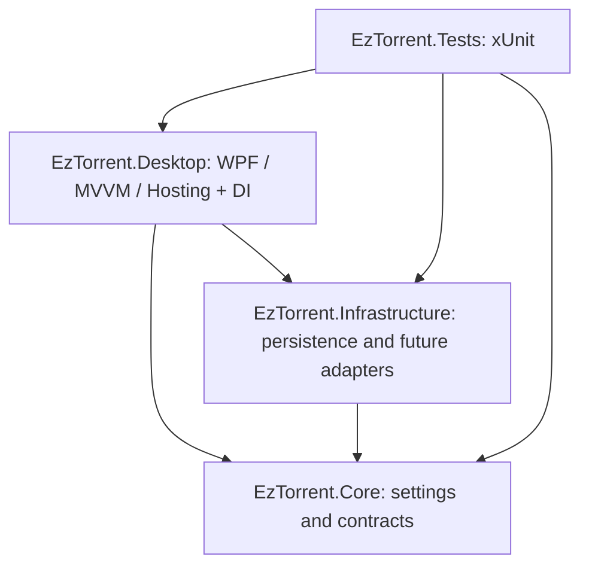

# Architecture

EzTorrent is a local modular desktop application, not a distributed system. The approved Foundation keeps a small dependency graph:

## Responsibilities

Core targets `net10.0` and has no project/package dependencies. It defines immutable settings, validation, supported values and the persistence contract. It must never reference WPF or MonoTorrent.

Infrastructure targets `net10.0` and references only Core. `JsonSettingsStore` implements Core's contract. A future engine adapter, Fast Resume store and update integration should be introduced only when needed and placed behind suitable contracts. MonoTorrent is the planned engine, not an installed or validated dependency in 0.1. Protocol support must be demonstrated against a selected package, never inferred from a library name.

Desktop targets `net10.0-windows` with `win-x64`. `App` constructs a minimal Generic Host without default environment/command-line configuration or logging providers, registers services and loads settings before constructing windows. CommunityToolkit.Mvvm provides observable presentation state and commands in `MainViewModel`. View code handles window lifecycle, native caption behavior, folder picker and the small preferences form; it contains no persistence implementation or torrent logic. `SettingsSession` serializes updates and notifies the presentation layer only after a successful write.

No hosted background services exist yet. Shutdown disposes the host. Engine integration must introduce graceful asynchronous stop, bounded shutdown and resume flushing before exit; disposing the Foundation host must not be reused as an engine shutdown design. A named local-session mutex enforces one Desktop instance, preventing same-session concurrent settings writers. Cross-session/profile synchronization is not provided.

## Persistence

Default path: `%LOCALAPPDATA%/EzTorrent/settings.json`. `EZTORRENT_DATA_DIRECTORY` is a development override for isolated manual validation. Settings schema 1 records theme, language override, close behavior, download folder, telemetry preference and setup completion. A blank download folder represents the planned Downloads default; Foundation creates no download folder or payload files. The Windows known-folder resolution must be implemented when actual destinations are needed.

`JsonSettingsStore` serializes accesses with an instance semaphore. Save writes a uniquely named temporary file in the destination directory, flushes it to disk, then uses `File.Replace` for an existing file or `File.Move` for an initial save. Cancellation is checked before replacement. The prior file is never deleted first. Temporary files are cleaned on ordinary failures; process/power loss can leave orphan `.tmp` files, and durability still depends on filesystem/hardware guarantees. Tested on the local Windows filesystem; network shares are not claimed. A failed cleanup cannot retain the semaphore indefinitely.

Missing settings return defaults without creating a file. Invalid JSON, null documents, unsupported schema versions, enums/languages or relative folder paths raise `SettingsFormatException`. Startup shows a localized message and exits without overwriting. Manual review/rename is the current recovery path. No migration or backup recovery is silently implied. Single-instance app ownership is required; the store does not provide cross-process locking.

## Presentation

Native WPF Fluent `ThemeMode` selects System/Light/Dark. Programmatic access carries a narrow `WPF0001` suppression because this SDK still labels that API experimental. Semantic Fluent resources and `SystemColors.AccentColorBrushKey` keep colors linked to Windows. Themes apply after saving; System delegates live OS changes to WPF.

ResourceManager loads neutral English and explicit en-US/pt-BR `.resx` resources. With no override, the user’s original Windows UI culture captured before any app override selects Portuguese for `pt`, otherwise English. Text is resolved at construction; language override changes apply on restart. Resource lookup uses the configured app UI culture explicitly, so dispatcher callbacks cannot fall back to the Windows culture after async startup. Formatting retains the user's Windows culture.

`WindowChrome` supplies caption drag, double-click, resize and system behavior. Accessible caption buttons invoke `SystemCommands`; a Windows 11 hit-test hook exposes the maximize button as `HTMAXBUTTON` for native Snap Layouts. All views inherit AppWindow and share one app-owned template with WindowStyle=None. No visible OS title bar/border, MessageBox or native folder picker is used. Nonclient maximize hover/press/capture-loss are synchronized with the app control; button bounds are calculated live. WM_GETMINMAXINFO uses the current monitor work area and device scaling, preserving the visible footer on maximization. High DPI is declared PerMonitorV2. Full DPI/accessibility/OS verification remains required.

## Dependency and distribution policy

`Directory.Packages.props` pins installed direct packages. `global.json` selects an available .NET 10 SDK feature band. Build warnings are errors. xUnit v3 is used instead of the legacy v2 meta-package. Tests cover persistence, legacy layout removal, app-culture consistency and a WPF folder-selection regression. The test project now targets net10.0-windows and references Desktop; the folder regression runs on an STA thread. Core remains independent and targets plain net10.0.

Velopack/GitHub Releases are the approved future distribution route. Foundation has no updater or packaging reference. Before automatic updates ship, authenticate packages/manifests using a verified trust chain, validate signer/publisher identity, constrain feeds, test tamper rejection and downgrade defense, and define recovery/key rotation. Checksums and TLS alone do not establish publisher authenticity. Do not invent a publisher, certificate or GitHub owner.

Telemetry is a stored optional preference defaulting to false. No collector, endpoint, network client or analytics package exists. Logs/graphs remain future design choices; no Serilog or chart library is installed in this milestone.

## F05 compatibility decision

Cards are the only transfer presentation. The old layout property/enum is removed. Schema 1 legacy JSON containing Grid/Cards remains readable; layout is ignored and omitted on the next save, while all other preferences remain intact. Folder browsing is an asynchronous app-owned dialog with explicit path selection, drive/parent navigation, cancellation and inline access errors. Editing its location clears any previous list selection.
